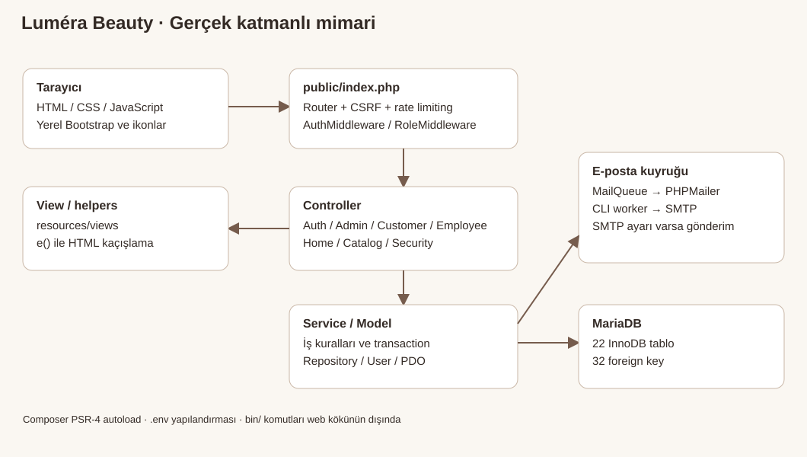
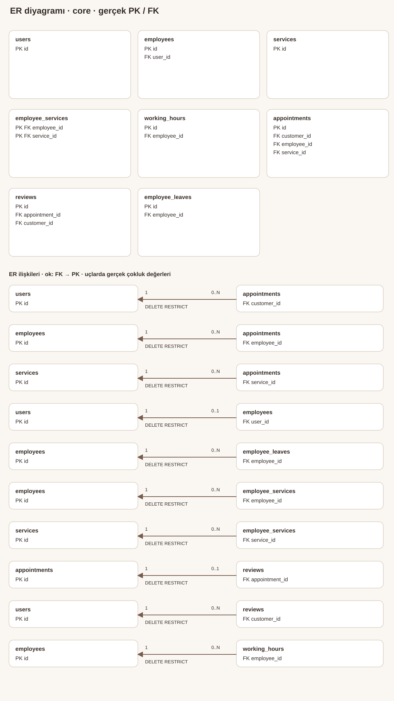
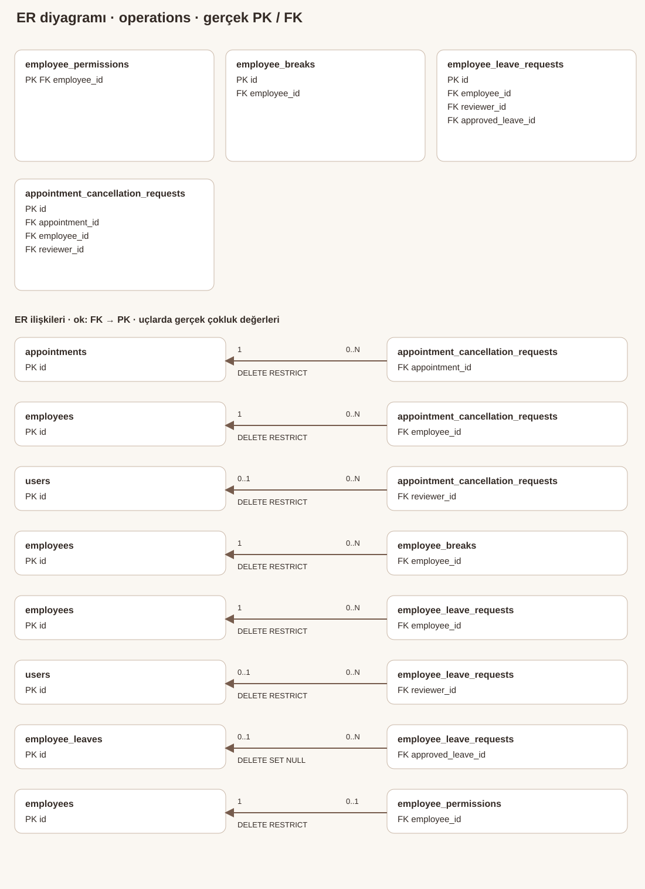
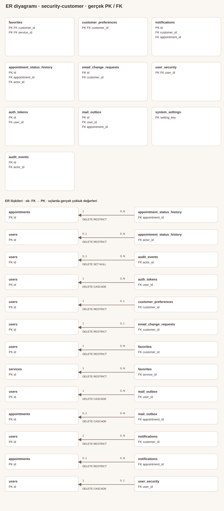
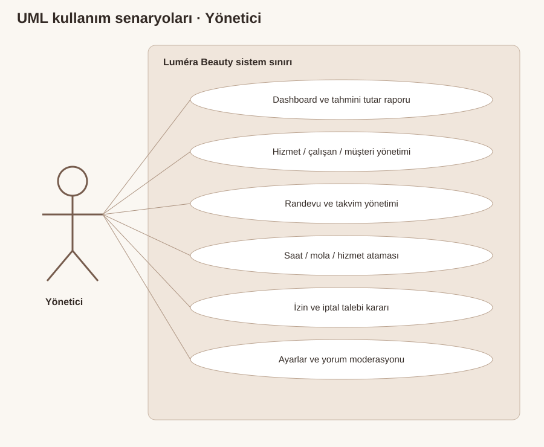
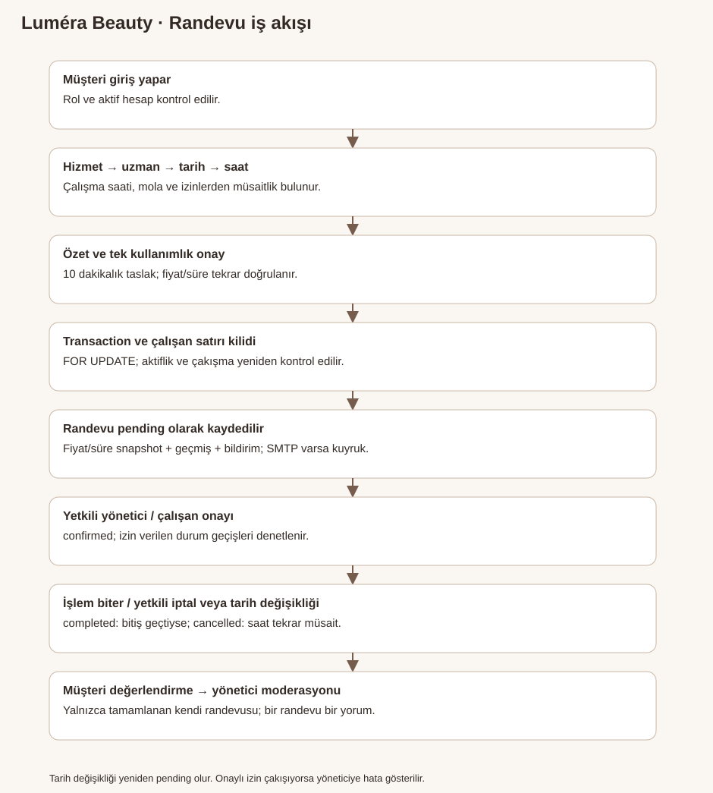

# Luméra Beauty — Güzellik Merkezi Yönetim Sistemi

## Amaç ve kapsam

Güzellik merkezi hizmetlerini, çalışan planlamasını ve müşteri randevularını tek bir ilişkisel veritabanı üzerinde yönetmek. Public katalog; CUSTOMER, EMPLOYEE, ADMIN panelleri; kayıt/oturum; randevu; izin; değerlendirme; uygulama içi bildirim ve yapılandırılabilir SMTP altyapısı uygulanmıştır. Ödeme/tahsilat, SMS, e-ticaret, sosyal giriş, mobil uygulama ve çok sunuculu dağıtım uygulanmamıştır.

## Kullanılan teknolojiler

PHP 8.2.12, MariaDB 10.4.32, Apache 2.4.58 / XAMPP; PDO native prepared statements, Composer PSR-4; HTML5, CSS3, JavaScript, yerel Bootstrap 5.3.8 ve ikonlar; PHPMailer 7.1.1. Çalışma ortamı Windows 11. Laravel, React, Node backend veya dış grafik servisi kullanılmaz. Mermaid/PlantUML dosyaları dokümantasyon kaynağıdır; uygulama bağımlılığı değildir. MySQL uyumluluğu hedeflenmiştir; bu teslimde çalışan veritabanı MariaDB'dir.

## Katmanlı MVC

public/index.php HTTP giriş noktasıdır. Router rota/HTTP metodunu eşleştirir; CSRF ve hız sınırlama denetlenir. AuthMiddleware aktif oturum/hesabı, RoleMiddleware rolü kontrol eder. Controller isteği alır, Service iş kurallarını uygular; Models/Repositories PDO ile veriye erişir. View PHP şablonları ve e() HTML kaçışlamasıyla ekranı üretir. Bootstrap environment/autoload/zaman dilimini kurar. bin/ CLI bakım/kurulum komutları public dışında tutulur.

## Veritabanı ve ER

24 tablo, 31 gerçek foreign key. [Tam ER Mermaid kaynağı](database-er.mmd), [sütun ve ilişki sözlüğü](DATABASE-DICTIONARY.md), [yapısal metadata](schema-metadata.json). Aşağıdaki levhaların ilişki listeleri birlikte bütün 31 bağı içerir; levhalar okunabilirlik için ayrılmıştır.

users rollerinin veritabanı değerleri CUSTOMER / EMPLOYEE / ADMIN'dir. employees.user_id kullanıcıyla tekil bağlıdır; employee_services çoktan çoğa atamayı tutar. appointments müşteri/çalışan/hizmeti ve fiyat/süre snapshot'ını taşır. reviews.appointment_id tekildir. working_hours, employee_breaks ve onaylı employee_leaves müsaitliği belirler. notifications.customer_id tarihsel alan adına rağmen bütün rollerin users.id değerine bağlanır. mail_outbox.payload şifreli kuyruk; auth_tokens.token_hash tek kullanımlık token özetidir. audit_events kişisel içerik yerine işlem türü/nesne kimliği tutar. Ayrıntılı ON DELETE / UPDATE kuralları gerçek SQL dışa aktarımında ve metadatada bulunur.

## Kullanıcı rolleri ve yetkiler

| İşlem | Müşteri | Çalışan | Yönetici |
|---|---|---|---|
| Public katalog | Evet | Evet | Evet |
| Randevu okuma | Kendi | Kendisine atanmış | Tümü |
| Oluşturma / tarih değiştirme | Kendi, zaman kurallarıyla | Doğrudan oluşturamaz | Aktif uygun hesaplarla |
| Onaylama / tamamlama | Hayır | employee_permissions izniyle | Durum geçişleriyle |
| İptal | Kendi, süre kuralıyla | İzin varsa talep | Doğrudan / talep kararı |
| Hizmet atama / saat / mola | Hayır | Salt okunur | Evet |
| İzin | Hayır | Kendi talebi | Çakışma denetimli karar |
| Profil | Kendi izinli alanları | Kendi izinli alanları | Müşteri/çalışan yönetimi |
| Değerlendirme | Kendi tamamlanmış randevusu | Hayır | Yayınla / gizle |
| Ayarlar / raporlar | Hayır | Kişisel performans | Merkez geneli |

Yeni açık kayıt her zaman CUSTOMER'dır. ADMIN hesabı ayrı güvenli interaktif CLI ile oluşturulur; public formdan rol alınmaz. Çalışanın varsayılan onay izni kapalı, tamamlama ve iptal talebi izni açıktır; yönetici değiştirebilir. ADMIN kullanıcı rolü yükseltme için herkese açık ekran yoktur.

## UML kullanım senaryoları

Düzenlenebilir [PlantUML kaynağı](use-cases.puml). Çizgiler aktörün kullanım senaryosuyla ilişkisini gösterir; alt yetkiler yukarıdaki tabloda sınırlanır.

## Sistem akışı ve iş kuralları

[Akış Mermaid kaynağı](appointment-flow.mmd). Randevu aralığı yarı açık [başlangıç,bitiş) olarak değerlendirilir; bitişe bitişik randevu kabul edilir. pending/confirmed bloke eder, cancelled bloke etmez. Çalışan satırı FOR UPDATE kilidi; randevu, izin ve çalışma planı değişiklikleri arasında ortak seri doğrulama sağlar. Listelenen müsait saatler öneridir, kayıttan hemen önce tekrar kontrol edilir. Hizmet fiyatı/süresi değişmişse eski müşteri özeti reddedilir. Tarih değişikliği yeniden pending olur. Bitiş gelmeden completed yapılamaz. Çakışan izin onayı reddedilir; yönetici ilgili randevuları açıkça yeniden planlar/iptal eder ve tekrar karar verir. Otomatik sessiz iptal yoktur.

## Güvenlik

PDO native parametreli sorgular; bcrypt password_hash/password_verify; POST + CSRF; sunucu doğrulaması; oturum kimliği yenileme; HttpOnly, SameSite=Lax ve HTTPS altında Secure cookie; boşta 30 dakika / toplam 8 saat; auth_version ile parola değişiminde diğer oturumların iptali. Login e-posta başına 5 / IP başına 30 deneme / 15 dakika; kritik işlemlerde ek sınırlar. Sahiplik sorguları her detay/mutasyonda sunucuda uygulanır. HTML metinleri e() ile kaçışlanır.

Şifre sıfırlama 30 dakika, kayıt doğrulama 24 saat, e-posta değişimi 15 dakika ve tek kullanımlıdır. SHA-256 token özeti saklanır. E-posta bağlantısının token'ı URL fragment'tedir; HTTP erişim kaydına query olarak gönderilmez. Posta kuyruğu AES-256-GCM; SMTP TLS sertifika kontrolü korunur. Loglar exception içeriği, parola, SQL parametresi veya token tutmaz. JPEG/PNG/WebP yüklemeleri MIME/gerçek görsel/boyut kontrolü, rastgele isim ve public/uploads çalıştırma yasağıyla korunur; SVG/PHP reddedilir.

## Test, kurulum ve kullanım

[Son test raporu](TEST-REPORT.md), [kurulum](INSTALLATION.md), [kullanım](USER-GUIDE.md), [dış yapılandırmalar](EXTERNAL-CONFIGURATION.md), [teslim kapsamı](DELIVERY-MANIFEST.md). Çalışan SMTP gönderimi loopback test sunucusuyla doğrulanmıştır; gerçek sağlayıcı teslimatı veya üretim HTTPS doğrulanmış değildir. Test ekran görüntüleri yalnızca izole sentetik hesaplardır.

## İçerik ve destek modülü

SupportController → SupportService → support_tickets: ziyaretçi ve oturumlu kullanıcılar CSRF ve hız sınırıyla talep kaydeder. Yalnız ADMIN talepleri listeler ve durum değiştirir; değişiklikler denetim kaydına yazılır. support_tickets.user_id nullable users FK, ON DELETE SET NULL. sample_content composite PK(entity_type,seed_key) ile idempotent örnek içerik kimliğini tutar; entity_id SQL FK değildir. 8 uzman/9 hizmet/20 eşleşme temiz kurulumda kaynak seed ile oluşur. [Güncel rapor](../CONTENT-SUPPORT-REPORT.md).
